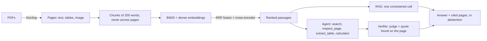

# docagent: a research assistant over scientific PDFs that cites its pages or abstains

Ask a question about a corpus of PDFs (papers, books). The system answers with a short answer and the
pages it relies on, or it abstains when the corpus does not support an answer. Everything runs locally
(an 8B vision-language model through Ollama, retrieval models from Hugging Face), with no vector
database and no agent framework: every part of the pipeline is written in this repository and tested
without a GPU.

**Research question.** Does an agent that can search, read pages and compute answer better than a
one-shot RAG pipeline, at what cost, and what does a verifier (an LLM judge that must quote the cited
page) change?

## How it works



1. **Ingestion** (`ingest.py`). Docling turns each PDF into pages: Markdown text in reading order,
   tables, and an image of the page; pypdfium2 is the fallback. The page `(doc_id, page)` is the unit
   of evidence: it is what a citation points to and what a human checks.
2. **Chunking** (`chunking.py`). Windows of 200 words with 50 words of overlap, never across a page,
   so every passage maps to exactly one page.
3. **Retrieval** (`bm25.py`, `dense.py`, `retrieval.py`, `rerank.py`). BM25 written from scratch on a
   sparse matrix, and dense embeddings (Qwen3-Embedding-0.6B, last-token pooling, exact cosine search).
   Each returns its 50 best chunks; the two lists are fused with Reciprocal Rank Fusion (k = 60) and
   the 50 first are reranked by a cross-encoder (bge-reranker-v2-m3). A page is as relevant as its
   best chunk (MaxP).
4. **Answering**, three ways:
   - **RAG** (`rag.py`): the 5 best passages go into one call; the reply is a JSON object
     (answer, citations, abstain) constrained by a schema.
   - **Agent** (`agent.py`, `tools.py`): a ReAct loop of at most 8 steps. At each step the model
     replies with one JSON action (constrained decoding, then validated again in Python). Tools:
     `search` (short excerpts), `inspect_page` (the page text, in parts for long pages, plus the page
     image), `extract_table` (the page's tables in Markdown), `calculator` (an AST whitelist, no `eval`).
   - **Agent + verifier** (`verifier.py`): every cited page goes through free checks first (the page
     exists, the agent actually saw it), then one judge call that must return a verbatim quote. The
     quote is searched on the page (at least 80% of its tokens in one window) and its numbers must be
     on the page. Pages that fail alone are judged together once, for answers computed from two pages.
     If no page survives, the agent gets one more attempt with the reasons; then it abstains.
5. **Evaluation** (`metrics_answers.py`, `evaluate.py`). Exact match after normalization for text,
   1% tolerance for numbers; citation precision; evidence seen; correct and false abstentions; cost
   (calls, tokens, latency). Bootstrap 95% intervals, exact McNemar tests with Holm correction, and
   unbiased pass^k / pass@k estimators for reliability.

Five rules hold everywhere: every passage shown to a model carries its doc_id and page; every model
call is constrained by a JSON schema and validated again in Python; everything measured is logged;
every module is testable without a GPU (a scripted LLM, tiny random models); no framework.

## Repository

| Path | What it is |
|---|---|
| `docagent/config.py`, `schema.py` | Settings (paths, models, limits) and shared types: Page, Chunk, PageRef, Question, Prediction |
| `docagent/llm.py` | Ollama client (JSON schema, page images) and `ScriptedLLM`, the test double |
| `docagent/ingest.py`, `chunking.py` | PDF to pages, pages to chunks |
| `docagent/bm25.py`, `dense.py`, `retrieval.py`, `rerank.py` | Sparse and dense retrieval, fusion, reranking |
| `docagent/metrics_retrieval.py` | Recall@k, MRR, bootstrap intervals |
| `docagent/rag.py` | The one-shot RAG baseline |
| `docagent/tools.py`, `agent.py` | The agent's tools, the argument validator, the ReAct loop |
| `docagent/verifier.py` | Judge, quote grounding, joint check, repair loop |
| `docagent/metrics_answers.py`, `evaluate.py` | Answer metrics, paired tests, the four configurations |
| `scripts/` | Ingestion, retrieval evaluation, one question, the benchmark, run inspection |
| `app/chat_app.py` | Chat interface (Streamlit) |
| `tests/` | Unit tests, no GPU and no Ollama needed |
| `data/questions.jsonl` | The questions (the PDFs, pages and images are not published) |

## Setup

Python 3.10 or later. Install PyTorch with CUDA first (see pytorch.org), then:

```
pip install -e .
ollama pull qwen3-vl:8b-instruct
```

The LLM takes about 8 GB of GPU memory (context of 16,384 tokens, temperature 0, seed 0).

## Use

```
python scripts/ingest_corpus.py                      # data/pdfs/*.pdf -> data/pages.jsonl + page images
python scripts/eval_retrieval.py --modes bm25 dense hybrid hybrid+rerank
python scripts/ask.py "your question"                # the agent, with its trace
streamlit run app/chat_app.py                        # chat interface, in the browser
python scripts/check_questions.py --max-overlap 0.6  # sanity checks of data/questions.jsonl
python scripts/run_benchmark.py                      # the four configurations -> runs/results.md (resumable)
python scripts/inspect_runs.py m03 u01               # per question: answers, verifier rejections, agent steps
python -m pytest tests
```

## Data

The corpus I used has 24 PDFs (1,984 pages), short papers and long books.
They are not in the repository; put yours in `data/pdfs/`. The current questions are 11 development
questions on one paper, the TabPFN article in Nature (Hollmann et al., 2025): 4 simple, 4 multistep
(a computation from numbers of the paper), 3 unanswerable (the paper does not contain the answer).
Every answerable question comes with its evidence pages.

## Results: a smoke test, not a study

| Configuration | Accuracy [95% CI] | False abstention | Correct abstention | Calls | Tokens | Latency (s) |
|---|---|---|---|---|---|---|
| RAG, dense | 0.45 [0.18, 0.73] | 0.25 | 1.00 | 1.0 | 1,579 | 1.5 |
| RAG, hybrid + rerank | 0.55 [0.27, 0.82] | 0.12 | 1.00 | 1.0 | 1,762 | 1.8 |
| Agent | 0.64 [0.36, 0.91] | 0.12 | 0.67 | 4.2 | 12,614 | 32.8 |
| Agent + verifier | 0.55 [0.27, 0.82] | 0.38 | 0.67 | 5.4 | 13,409 | 42.5 |

With 11 questions, no difference is significant: the exact McNemar test gives p = 1 for every pair.
These numbers show that the pipeline works end to end and give orders of magnitude for the cost
(the agent uses about 7 times the tokens of hybrid RAG and 18 times its latency); they do not rank
the configurations.

## What the runs taught me

1. **Truncated pages hid the evidence.** The agent saw at most 5,000 characters of a page and the judge
   6,000, but the methods pages of the TabPFN paper are 7,000 to 9,000 characters long. In a first
   run, the judge rejected a correct answer (m03) because the number it relies on (2,048) is at the
   bottom of page 10. Fix: `inspect_page` reads a long page in parts that fit in one observation, and
   the judge sees the whole page. The answer is then accepted.
2. **Seeing the whole page exposed the judge.** In the first run the verifier abstained on every
   unanswerable question, but only because the judge never saw the misleading passage of u01 (the
   learning rates *tested*, "in [0.0001, 0.0005]", at the end of page 10). With the whole page, it
   accepts that range as the learning rate *finally used*, and it accepts "32" as a GPU time per
   sample (s03) from a sentence about a CPU time before an optimization. The quote is real; the
   answer does not answer the question. The verifier checks support, not truth, and an 8B judge
   checks support loosely.
3. **Runs are not deterministic.** At temperature 0 with a fixed seed, the same prompt can still
   produce another trajectory on a GPU: in each run, the first attempt of the verified agent differed
   from the plain agent's on 2 questions out of 11 (s01: another search, the wrong page, an abstention
   the verifier had nothing to do with). Differences of one or two questions are within this noise.
4. **The small model is clumsy with tools.** It often forgets the `abstain` argument of
   `final_answer` (a wasted step), passes `doc_id: "null"` or invents a doc_id (m02: eight failed
   searches in a row, then abstention), and answered "Not applicable" to m04 without searching at all.
5. **RAG does not compute.** With the evidence in its five passages, RAG answered 169.3 (CatBoost's
   time) instead of the ratio 141 (m04), and 500 instead of 1,000 (m01). The agent computes with its
   calculator (0.2 / 0.0002 = 1,000).
6. **Figures are hard to verify.** s04 asks for a number drawn in a figure ("2D TabPFN layer (12×)").
   No configuration answered it in the last run; in the first one, the verified agent read it, but the
   judge rejected the page.

## Limitations and next steps

- 11 questions on one paper. The full study needs about 60 questions, 15 per category (simple,
  multistep, multi-document, unanswerable), written without looking at the results.
- The judge is the same 8B model and its agreement with human labels is not measured yet
  (Cohen's kappa on about 40 annotated pages). A stricter judging criterion (same quantity, same
  conditions; a range of candidates is not one value) is the next thing to try.
- The verified agent re-runs the agent instead of verifying the plain agent's own run, so the
  comparison mixes the verifier's effect with run-to-run noise.
- Verification reads text only: an answer read from a figure can be verified only if Docling
  extracted the text of the figure.
- The corpus mixes short papers and long books; I plan to make it more homogeneous.
- The trust boundary is the corpus: a page that states something false supports a false answer.

The project follows the brief "Building the Legend, Project D" (given plumbing: configuration, shared
types, benchmark scripts, the minimal demo `app/streamlit_app.py`); the pipeline components and the
tests are implemented in this repository.
